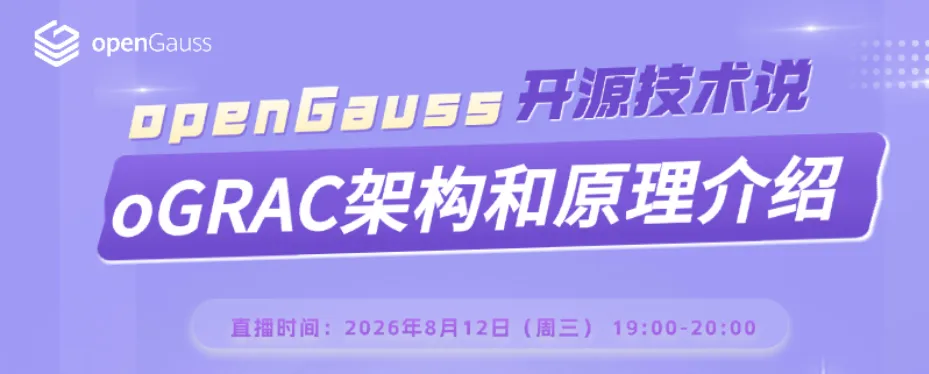
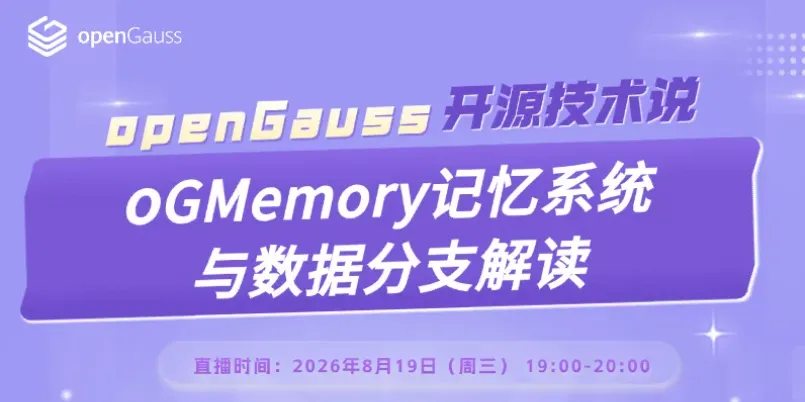
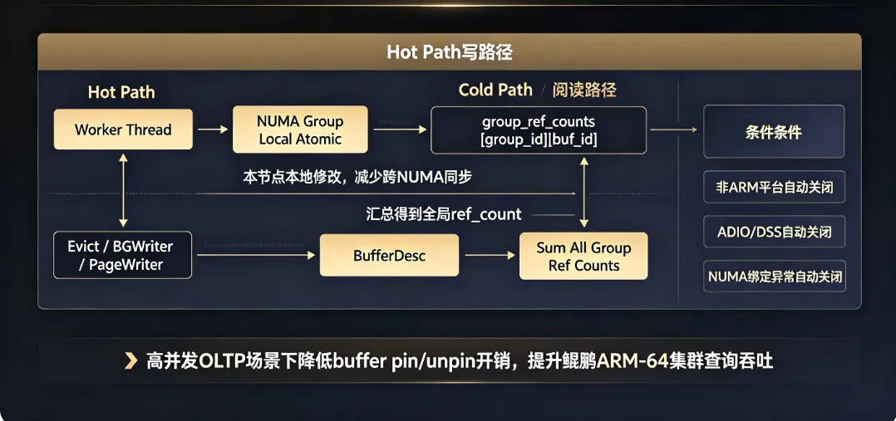
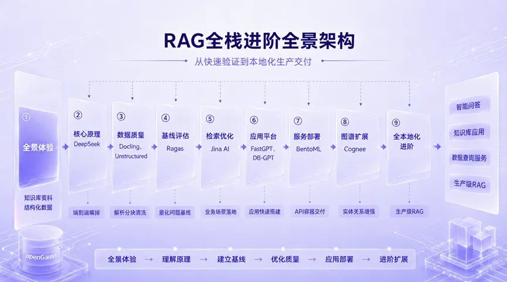
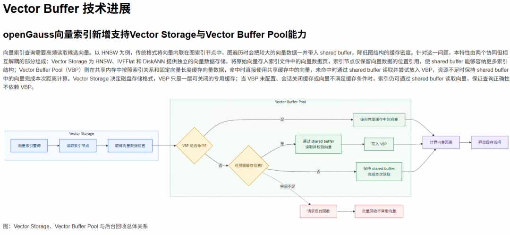
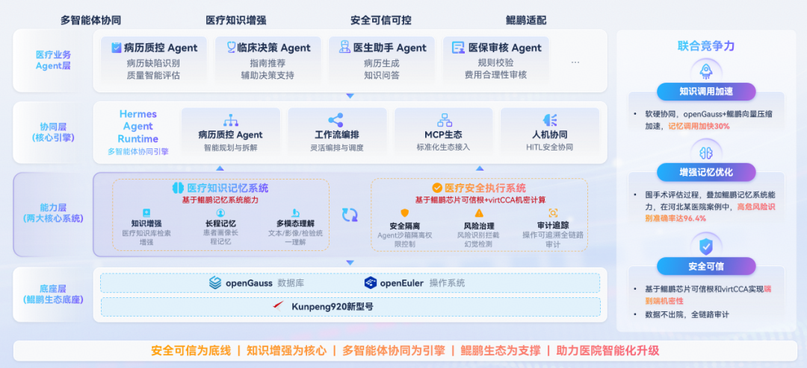

## 1. 概述

2026年8月，openGauss 社区持续深化技术创新与生态协同，在社区规模、产业生态、开发者建设和技术演进等方面取得积极进展。截至8月底，社区开发者规模突破8800人，单位成员达到915家，全球累计下载量突破620万，社区影响力持续提升。生态建设方面，社区亮相 DTCC 2026，围绕“1+2”发展战略展示数据库技术与生态成果；官网 SIG 中心正式上线，并发布《生成式AI工具使用与开源贡献策略》，持续完善社区协作体系，推动更多开发者参与开源实践。技术创新方面，推出鲲鹏大 NUMA Buffer Pin 性能优化方案，DataVec 向量引擎新增专用缓存能力，进一步提升数据库高并发查询与向量数据处理性能；产业生态方面，软硬件兼容性测评产品累计超过3600款，8月新增北向（ISV）产品59款，生态覆盖持续扩大。

整体来看，社区规模、生态、技术与产业应用协同推进，持续提升开源数据库技术影响力和产业竞争力，为7.0.0 LTS及oGRAC首个可商用版本发布，以及“1+2”发展战略进一步落地夯实基础。

（本月报阅读时长约5分钟）

## 2. 社区规模

截至 2026 年 8 月 31 日，openGauss 社区用户累计超过 **659.4 万**，单位会员达 **915 家**，SIG 组 **28 个**，超过 **8.8K 名开发者**在社区持续贡献。社区累计产生 **32.6k 个 PR**、**28.4K 条 Issue**、**687.6K 条 Comment**。

> 社区贡献看板（截止 2026/08/31）

## 3. 社区事件

### 锚定 "1+2" 战略 共筑技术高地 ——openGauss 亮相 DTCC 2026

2026年8月22日，第17届中国数据库技术大会（DTCC）在京举行，openGauss开源社区重磅亮相。社区核心专家熊钦发表主题演讲，系统阐释“1+2”战略：内核持续演进，oGRAC多写性能跃升至470万tpmC，AI原生多模数据库涵盖多模检索引擎、Serverless DB及oGMemory记忆引擎，为Agentic时代重塑数据底座。

大会同期预告9月底将发布7.0.0 LTS及oGRAC首个可商用版本，并展示超节点数据库技术探索成果，进一步彰显开源数据库技术创新与演进方向。

原文阅读：[锚定 "1+2" 战略 共筑技术高地 ——openGauss 亮相 DTCC 2026](https://mp.weixin.qq.com/s?__biz=Mzk2NDg1NjAwNA==&mid=2247485679&idx=1&sn=55d3dcc520413172702c6b469ba3577d&scene=21&poc_token=HMuSzGqjUpj1CFjlfHf7vcHpUL5lvw7fRq4DzeyF)

### 官网 SIG 中心正式上线，提升社区协作与参与效率

openGauss 社区官网正式上线 SIG 中心。针对用户难以快速获取 SIG 联系方式、SIG 职责与技术方向展示分散且不够清晰的问题，SIG 中心集中呈现各 SIG 的技术领域、邮箱联系方式、代码仓及 Maintainer 等关键信息，并支持按名称或关键词快速检索。

用户可通过 SIG 中心快速了解社区各技术小组的定位与运作方式，找到对应的交流和参与入口；同时，页面提供 SIG 角色说明、会议指南、贡献指引及新 SIG 申请流程，进一步降低开发者参与社区协作和贡献的门槛。SIG 中心的上线完善了社区治理信息的线上展示，增强了 openGauss 社区的开放协作体验。

页面入口：(https://opengauss.org/zh/sig/sig-list/)

### openGauss 社区发布《生成式 AI 工具使用与开源贡献策略》

openGauss 社区发布《生成式 AI 工具使用与开源贡献策略》，明确生成式 AI 工具可用于辅助代码、文档等开源贡献，但贡献者仍需对提交内容承担完整责任。策略要求贡献者能够清晰说明提交的技术内容，确保 AI 辅助开发过程可追溯、可解释。

社区同步在多个环节持续完善配套措施：通过 PR 模板引导贡献者如实声明 AI 模型的使用情况；在仓库 AGENTS.md 中以 Agent 可理解、可执行的形式沉淀社区代码提交规范，引导 AI 工具在生成并提交 PR 时遵循社区要求；同时依托 CI 自动校验流水线，对 PR 中的 AI 使用声明与 Commit Message 中的 Co-Authored-By 等信息进行一致性校验，提升 AI 辅助贡献的透明度与可追溯性。

《生成式 AI 工具使用与开源贡献策略》的发布为开发者合理、高效地使用 AI 工具参与社区建设提供了清晰指引，在提升贡献效率的同时，保障社区代码质量、开源合规与长期可维护性。

原文阅读：[一图读懂 | openGauss 社区 AI 亲和有哪些新变化？](https://mp.weixin.qq.com/s?__biz=Mzk2NDg1NjAwNA==&mid=2247485749&idx=1&sn=807d7f86e14866e4ea46c32bbdaf23c5&scene=21&poc_token=HJiXzGqjDdVbYEZOcVWu3w6D3EZ3nvvLCZZX7dT1)

### 开展《openGauss 开源技术说》直播栏目

8月《openGauss开源技术说》系列直播连续三周精彩开讲，围绕核心技术与开发者体验带来深度分享。
第一期内容系统讲解了oGRAC整体架构、页面流转、缓存一致性及事务实现，助力开发者掌握多节点并发写技术难点与内核方案。

第二期则聚焦oGMemory记忆系统与数据分支，详解oGMemory设计架构、操作方法，以及存储层与计算层协作下的分支创建与合并多版本管理。

第三期分享了AI代码合规追溯与度量及AI友好型官网GEO优化，深入剖析oGRAC的RTO容灾原理与RBP加速恢复机制。

三期直播回放均已上线，可通过 openGauss视频号、华为计算视频号、黄大年茶思屋官网、华为ICT学院视频号 观看，欢迎广大开发者随时回顾。

### openGauss 社区开源实习持续开展中

openGauss 开源实习聚焦数据库生态建设与工具能力升级，由社区资深导师全程指导，成果均贡献至openGauss 开源社区，核心任务覆盖自动化测试体系建设、AI生态组件对接、MySQL 生态适配、高可用组件易用性优化等方向。

参与开源实习可获得：
1.丰厚的实习薪资
2.官方实习证明（中国科学院软件研究所）：为简历背书加持，就业更具优势
3.导师辅导：资深导师全程辅导，夯实开发能力
4.参与企业级项目，接触产业一线技术实践
5.积累真实项目经验，让简历更有含金量

原文阅读：[加入openGauss开源实习，挑战数据库核心技术开发任务](https://mp.weixin.qq.com/s?__biz=Mzk2NDg1NjAwNA==&mid=2247485581&idx=1&sn=cce6663c870c196917b7ca1cf4a279b6&scene=21&poc_token=HBqZzGqjNZ3nwwgteamVTKUfcXKIhrcyQz9wFJdl)

## 4. 技术进展

### 鲲鹏大NUMA服务器高并发Buffer Pin性能优化

openGauss 鲲鹏 ARM‑64 大 NUMA 服务器高并发场景提供 buffer pin 性能优化方案。原有全局单实例 BufferDesc 引用计数，在跨 NUMA 节点高频并发`PinBuffer/UnpinBuffer`时会产生严重的 Cache‑Line 伪共享与原子指令颠簸，成为读业务性能瓶颈。方案引入 NUMA‑group 分组引用计数机制，每个 NUMA 组维护独立的 pin 计数数组，热路径下线程仅修改本 NUMA 节点本地内存上的原子变量，大幅减少跨 NUMA 的缓存同步开销；

读取全局引用计数时，通过汇总所有 NUMA 分组计数值得到结果。新增 GUC 开关`enable_group_ref_cnt`，为 postmaster 级重启生效参数，非 ARM 平台、开启 ADIO/DSS 存储、NUMA 线程绑定异常时特性将自动关闭。该优化显著降低高并发 OLTP 场景 buffer pin/unpin 的锁争用开销，提升鲲鹏多 NUMA 集群的查询吞吐能力。

### 推出“RAG全栈进阶全景架构”专栏，首篇n8n集成实践正式发布

8月，openGauss社区正式推出 “RAG全栈进阶全景架构” 技术专栏，为开发者提供从零到一构建RAG应用的全链路知识体系。专栏按照 “全景体验→理解原理→建立基线→优化质量→应用部署→进阶扩展” 的逻辑系统推进，

首篇文章系统介绍了借助n8n开源自动化平台零代码体验DataVec向量能力的完整路径。openGauss 7.0.0-RC1已将DataVec深度集成至内核，开发者通过Docker一键启动即可获得原生向量存储与检索能力。

后续专栏将陆续覆盖DeepSeek手动实现最小RAG、Ragas基线评估、Jina AI重排优化、FastGPT/DB-GPT应用平台、BentoML服务部署、Cognee图谱增强及昇腾NPU全本地化部署等主题，欢迎持续关注。

### openGauss向量索引新增向量专用缓存能力

向量索引查询需要高频读取候选向量。以 HNSW 为例，传统格式将向量内联在图索引节点中，图遍历时会把较大的向量数据一并带入 shared buffer，降低图结构的缓存密度。

针对这一问题，本特性由两个协同但相互解耦的部分组成：向量存储解耦能力为 HNSW、IVFFlat 和 DiskANN 提供独立的向量数据存储，将原始向量存入索引文件中的向量数据页，索引节点仅保留向量数据的位置引用，使 shared buffer 能够容纳更多索引结构；向量专用缓存则在内存中按照索引关系和固定向量长度缓存向量数据，命中时直接使用专用缓存中的向量，未命中时通过 shared buffer 读取。能力组合后可以优化向量读取速度和内存占用，达到性能提升的目的。

## 5. 技术生态

### 惠每科技｜基于openGauss+鲲鹏，打造医疗超级智能体底座

惠每科技基于openGauss+鲲鹏打造的医疗超级智能体平台引发广泛关注。该平台底层采用openGauss数据库，充分发挥其原生向量引擎能力，实现医疗海量数据的向量压缩与高速检索。

在此基础上构建的医疗知识记忆系统，依托openGauss高效向量检索，完成患者全周期长程病程记忆与多模态统一理解，破解大模型“长病程失忆”顽疾。在河北某医院落地验证中，依托openGauss向量压缩加速，知识调用速度提升30%，高危风险识别准确率达96.4%。这一实践充分展现了openGauss在AI医疗场景中作为智能数据底座的强大支撑能力。

原文阅读：[惠每科技｜基于openGauss+鲲鹏，打造医疗超级智能体底座](https://mp.weixin.qq.com/s?__biz=Mzk2NDg1NjAwNA==&mid=2247485617&idx=1&sn=084597b2108819c4ff00b41c038b7b39&scene=21&poc_token=HOmezGqjyJjEEbib9AtMyXcwMLm2ZcAQ5r11mPlW)

## 6. 软硬件兼容性测评

截至2026年8月底，通过openGauss软硬件兼容性测评的产品达3600+款。8月新增北向（ISV）新增59款。

- 兼容性列表：

<https://opengauss.org/zh/compatibility/>

- DBV 技术测评列表：

<https://opengauss.org/zh/certification/>

## 7. 致谢

openGauss 社区的成长，从来不是某一个人的努力，而是大家并肩同行、共同创造的结果。每一次提交、每一次讨论、每一次分享，都是社区前行路上的点点星光，汇聚成今天的成果与温度。

也正因为社区持续涌现出丰富的实践与成果，月报内容难免有所疏漏，如有未被记录的亮点与贡献，欢迎随时与我们联系补充，让更多努力被看见、被传递。在此，向为本期月报提供资料支持的各 SIG 组以及广大开发者朋友们致以诚挚的感谢与敬意。

若您希望在月报中增加您的工作内容，或对内容有任何改进建议，请联系：  
**common@public.opengauss.org**
