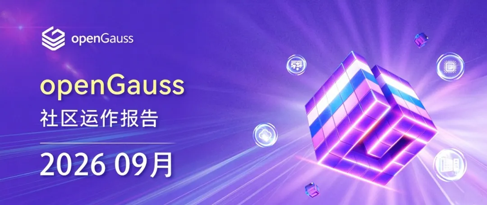
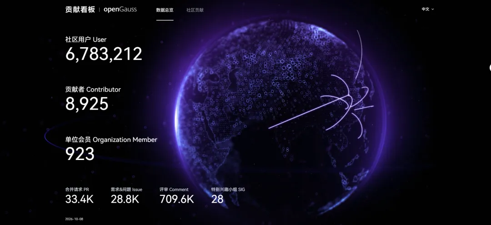
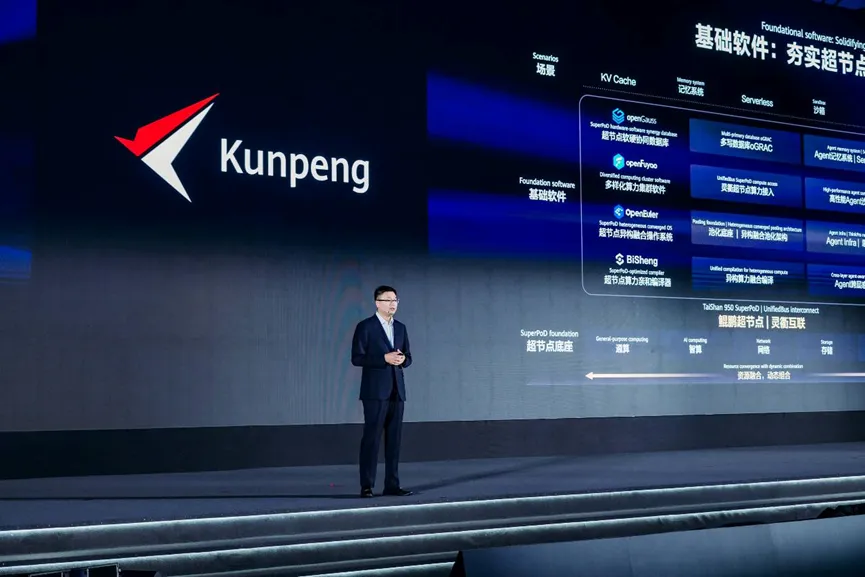
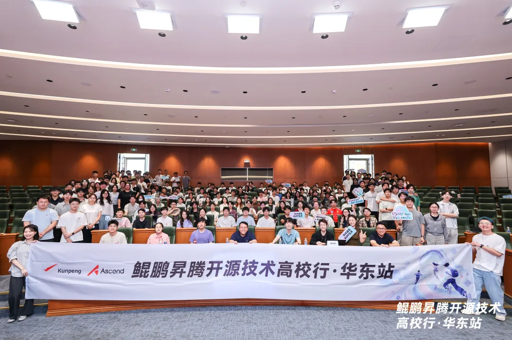
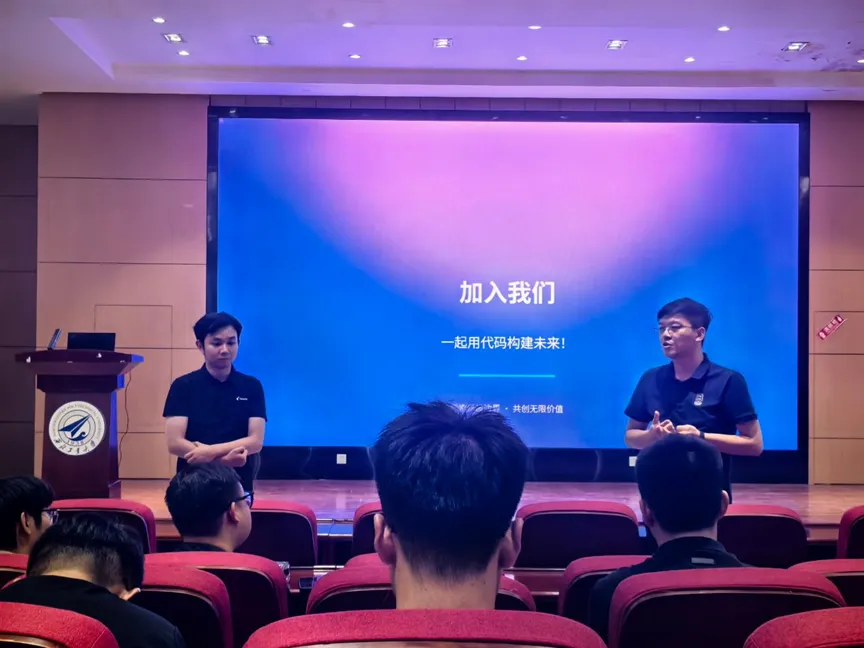
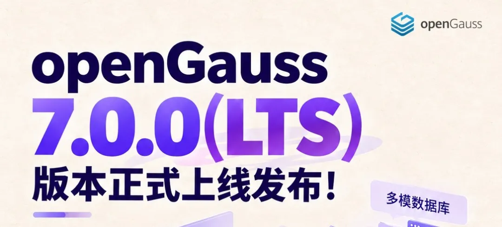
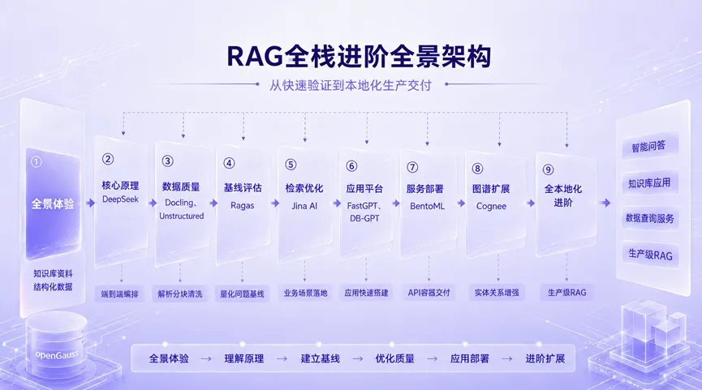
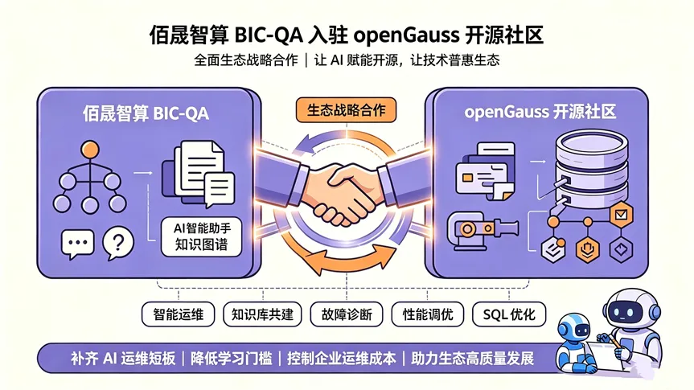

## 1. 概述

2026年9月，openGauss社区持续深化技术创新与生态协同，在社区规模、产业生态、开发者建设和技术演进等方面取得积极进展。截至9月底，社区开发者规模突破8900人，单位会员达923家，全球累计下载量突破678.3万，社区影响力持续提升。生态建设方面，社区亮相华为全联接大会2026，联合汇智通信发布数智融合AI数据湖方案，BIC-QA智能知识问答平台正式入驻。开发者建设方面，开源技术高校行华东站、西北工业大学Meetup成功举办，发布开源实习课题与人才引进计划。技术创新方面，openGauss 7.0.0 LTS正式上线，围绕“1+2”战略在内核底座、多模数据库、oGRAC多主数据库全面增强；SQL优化器支持UNION ALL分支快速启动重排；“RAG全栈进阶全景架构”专栏持续更新。

整体来看，社区规模、生态、技术与产业应用协同推进，为Agentic AI时代企业级开源数据底座建设及“1+2”战略落地夯实基础。

（本月报阅读时长约5分钟）

## 2. 社区规模

截至 2026 年 9 月 30 日，openGauss 社区用户累计超过 **678.3 万**，单位会员达 **923 家**，SIG 组 **28 个**，超过 **8.9K 名开发者**在社区持续贡献。社区累计产生 **33.4k 个 PR**、**28.8K 条 Issue**、**709.6K 条 Comment**。

> 社区贡献看板（截止 2026/09/30）

## 3. 社区事件

### 华为全联接大会 2026｜openGauss 携超节点多写、AI多模原生能力亮相

9月17-19日，华为全联接大会2026在上海举行，openGauss亮相鲲鹏计算产业峰会及展区，展示超节点多写、AI多模原生与内核升级，并预告openGauss 7.0.0 LTS版本将依托高性能数据底座与 AI 多模能力的升级，构建 Agentic AI 时代企业级开源数据底座。

openGauss联合openEuler、openFuyao共建超节点软硬协同体系，oGRAC双节点多写达570万tpmC；Serverless DB、oGMemory赋能Agentic AI，Token开销降低50%。新版本向量检索时延低于100ms，RTO低于10秒。沙利文报告显示，openGauss 2025年线下集中式关系型数据库新增份额35.02%，实现三连冠。

原文阅读：[华为全联接大会 2026｜openGauss 携超节点多写、AI多模原生能力亮相](https://mp.weixin.qq.com/s?__biz=Mzk2NDg1NjAwNA==&mid=2247486025&idx=1&sn=69c90140cd41059549135827393f47fb&scene=21&poc_token=HK7zzWqjpx5Zjj1YVy0uouaMP2AxARyyAlKxTfMR)

### 技术向深，生态向远：openGauss走进华东区高校回顾

9月12日，开源技术高校行·华东站在上海练秋湖举行，近200名高校学子参与。openGauss社区围绕RAG、Agent、AI数据底座与智能问答展开交流，通过“主题分享+Workshop”推动从认知到实践。

社区运营孙爽介绍DataVec向量检索、RAG证据检索、MCP Server工具化及oGMemory长期记忆能力，并分享83道开源实习任务。Workshop中，同学们动手完成文档切分、向量生成、写入openGauss、HNSW索引创建，体验TOP_K与THRESHOLD调参及n8n RAG链路。未来openGauss将持续走进更多城市与校园，携手青年开发者共建AI数据底座与开源生态。

页面入口：(https://mp.weixin.qq.com/s?__biz=Mzk2NDg1NjAwNA==&mid=2247486068&idx=1&sn=ea8cfe45009dce18f3b90ccff6e90c34&scene=21&poc_token=HOrzzWqjJVhfRB0J82r48Lv9X9cAxAHE_CSABCoM)

### openGauss Meetup｜西北工业大学站圆满落幕，共探数据库内核，解锁开源实习新机遇

9月16日下午，openGauss Meetup校园行走进西北工业大学长安校区计算机报告厅。活动围绕数据库产业发展、openGauss生态规划、内核技术、AI原生数据库、开源实习课题发布五大主题展开。

openGauss社区技术专家现场解读产业趋势与生态布局，分享内核软硬协同实践，介绍AI原生特性。活动发布开源实习课题与人才引进计划，涵盖真实项目、Committer导师制、成长激励及多元方向。自由交流环节，社区专家围绕学习路线、零基础上手、实习报名等问题为同学们答疑。活动圆满结束，openGauss将持续走进高校，连接学子，共建开源生态。

原文阅读：[openGauss Meetup｜西北工业大学站圆满落幕，共探数据库内核，解锁开源实习新机遇](https://mp.weixin.qq.com/s?__biz=Mzk2NDg1NjAwNA==&mid=2247486068&idx=2&sn=b8cd4fa0e03bf9bae70097a5fe50d885&scene=21&poc_token=HBv0zWqjk65cJhbD1UAdpfmRt-saSGmCZDCDdyuC)

## 4. 技术分享

### openGauss 7.0.0(LTS) 版本正式上线！

2026年9月30日，openGauss 7.0.0(LTS)正式上线。作为社区最新长期支持版本，生命周期3年，围绕“1+2”战略在内核底座、多模数据库、oGRAC多主数据库全面增强。新增鲲鹏超节点软硬协同优化、故障检测<1s、oGMemory对接OpenClaw使Token开销降低50%、BM25索引空间占用减少40%、ServerlessDB支持分支合并、oGRAC多写能力增强及Oracle全量迁移工具等，欢迎下载体验并反馈。

### SQL引擎优化器支持 UNION ALL 分支快速启动重排机制

社区在SQL引擎优化器方面新增 union_all_faststart 重写规则。对于无顶层 ORDER BY 的 UNION ALL 查询，当仅需少量结果时，若前置分支取数成本较高，可能延长查询等待时间。开启该规则后，优化器将根据 LIMIT/OFFSET 需求量和分支成本估算值动态调整分支执行顺序，优先执行代价较低的分支，从而快速返回结果，有效缩短轻量结果查询的响应时间，进一步提升复杂查询场景下的用户体验。该特性进一步增强了 openGauss 在查询优化领域的竞争力，为开发者提供了更高效的数据检索能力。

详细说明见：

https://docs.opengauss.org/zh/docs/latest/performance_tuning_guide/case_modifying_the_guc_parameter_rewrite_rule.html#union-all-%E5%88%86%E6%94%AF%E5%BF%AB%E9%80%9F%E5%90%AF%E5%8A%A8%E9%87%8D%E6%8E%92-union_all_faststart

### “RAG全栈进阶全景架构”专栏持续更新

openGauss社区持续更新 “RAG全栈进阶全景架构” 技术专栏，为开发者提供从零到一构建RAG应用的全链路知识体系。专栏按照 “全景体验→理解原理→建立基线→优化质量→应用部署→进阶扩展” 的逻辑系统推进。

本月重点更新“理解原理”与“优化质量”阶段：通过《代码拆解 RAG 核心链路：openGauss DataVec × DeepSeek 的原理实践》手写代码逐行拆解向量化、入库、检索、生成四环节；引入Docling与Unstructured两大文档处理工具，分别解决复杂布局解析与元素级智能分块难题，为高质量RAG数据入口提供实践指导。专栏助力开发者系统掌握openGauss DataVec作为AI数据底座的核心能力，加速RAG应用落地。

## 5. 技术生态

### openGauss联合汇智通信发布基于异构加速的新一代 AI 知识湖方案

9月18日，在华为全联接大会2026“更快更好建设数智基础设施”分论坛上，openGauss社区联合广州汇智通信技术有限公司发布数智融合AI数据湖方案。汇智通信人工智能研究院院长王磊分享联合实践成果：在“相柳数据平台”中引入openGauss作为核心向量引擎，通过CPU与NPU协同加速，应对千亿级数据规模；将多模数据标准化处理并入库，转化为“AI ready数据”，以语义检索赋予海量非结构化数据“可问、可搜”能力。

此次发布展现了openGauss在向量引擎、异构加速与AI数据底座方面的技术能力，标志其加速向AI原生数据基础设施演进。未来，openGauss将继续携手生态伙伴，深化AI知识湖、向量检索、异构加速等方向协同创新。

### BIC-QA进驻openGauss社区，佰晟智算与openGauss达成全面生态合作

openGauss社区与佰晟智算达成全面生态合作，BIC-QA智能数据库知识问答平台正式入驻。双方将围绕openGauss智能运维、知识库共建、故障诊断、性能调优、SQL优化等方向深度协同，补齐openGauss生态AI运维短板，降低开发者学习门槛与企业运维成本。

BIC-QA已建成10万+ openGauss专属知识点，覆盖架构、源码、部署运维、调优、故障排查、迁移信创等场景，提供精准可溯源解答。未来，BIC-QA将作为openGauss社区官方智能知识助手，持续免费提供技术支撑，完善openGauss智能工具链，助力生态规模化发展。

## 6. 软硬件兼容性测评

截至2026年9月，通过openGauss软硬件兼容性测评的产品达3700+款。其中，9月新增北向（ISV）15款。

- 兼容性列表：

<https://opengauss.org/zh/compatibility/>

- DBV 技术测评列表：

<https://opengauss.org/zh/certification/>

## 7. 致谢

openGauss 社区的成长，从来不是某一个人的努力，而是大家并肩同行、共同创造的结果。每一次提交、每一次讨论、每一次分享，都是社区前行路上的点点星光，汇聚成今天的成果与温度。

也正因为社区持续涌现出丰富的实践与成果，月报内容难免有所疏漏，如有未被记录的亮点与贡献，欢迎随时与我们联系补充，让更多努力被看见、被传递。在此，向为本期月报提供资料支持的各 SIG 组以及广大开发者朋友们致以诚挚的感谢与敬意。

若您希望在月报中增加您的工作内容，或对内容有任何改进建议，请联系：  
**common@public.opengauss.org**
