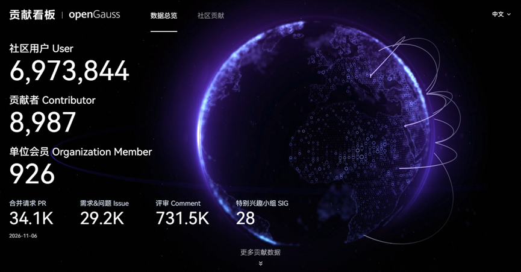
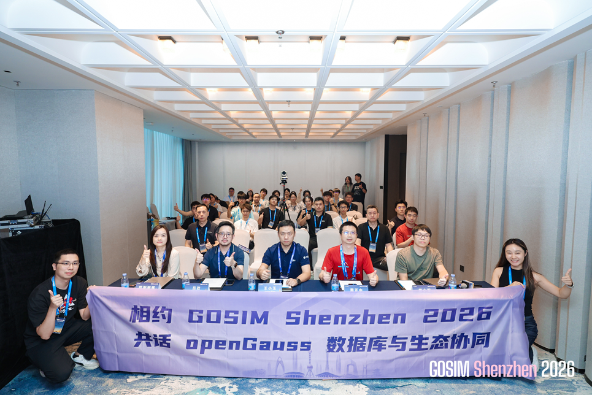
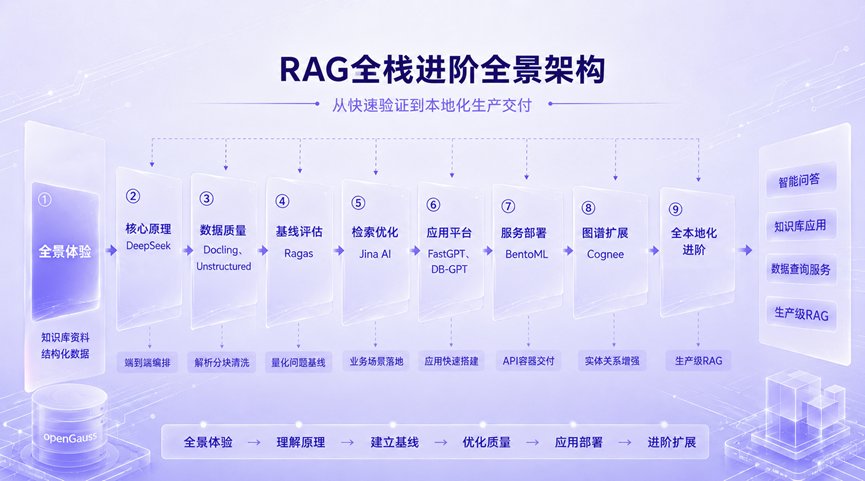

## 1. 概述

2026年10月，openGauss社区持续深化技术创新与生态协同，在社区规模、产业生态和技术演进等方面取得积极进展。截至10月底，社区开发者规模突破8900人，单位会员达926家，全球累计下载量突破697.3万，社区影响力持续提升。技术创新方面，openGauss 7.0.0 LTS正式上线，围绕“1+2”战略在内核底座、多模数据库、oGRAC多主数据库全面增强。生态建设方面，IDC报告显示，基于openGauss的海量数据库以64.8%的增长率位列所有厂商第一；GOSIM Shenzhen 2026 openGauss数据库与生态协同论坛在深圳举办，围绕7.0.0 LTS发布探讨AI时代数据库演进与生态协同；多位资深DBA开展oGRAC众测，覆盖安装部署、多实例同步写入、线性扩展、故障恢复等核心场景。

整体来看，社区规模、生态、技术与产业应用协同推进，为Agentic AI时代企业级开源数据底座建设及“1+2”战略落地夯实基础。

（本月报阅读时长约5分钟）

## 2. 社区规模

截至 2026 年 10 月 31 日，openGauss 社区用户累计超过 **697.3 万**，单位会员达 **926 家**，SIG 组 **28 个**，超过 **8.9K 名开发者**在社区持续贡献。社区累计产生 **34.1k 个 PR**、**29.2K 条 Issue**、**731.5K 条 Comment**。

> 社区贡献看板（截止 2026/10/30）

## 3. 社区事件

### GOSIM Shenzhen 2026 openGauss 数据库与生态协同论坛活动回顾

2026年10月16日，GOSIM Shenzhen 2026 openGauss数据库与生态协同论坛在深圳举办。论坛围绕openGauss 7.0.0 LTS新版本发布，通过五场主题分享与一场圆桌讨论，聚焦AI时代数据库技术演进、oGRAC共享存储多写架构、向量检索与AI应用数据底座、企业AI融合检索及端侧智能数据管理等方向，探讨社区与产业伙伴协同推进技术创新和行业应用的路径。

原文阅读：[GOSIM Shenzhen 2026 openGauss 数据库与生态协同论坛活动回顾](https://mp.weixin.qq.com/s/pfgRBTfYEwWiUP2TLczInA)

产业伙伴分享磐维、Vastbase、IntarkDB等实践，探讨社区协同推进技术创新与行业应用。未来，社区将以7.0.0 LTS为契机，围绕多写架构、AI数据管理、嵌入式数据库深化技术共建与联合验证，持续完善开放协作的开源生态。

### 多位资深DBA开展oGRAC众测，实测开源多主架构数据库效果

oGRAC多写能力已具备成熟可用状态。为进一步推广该多写特性，完善其商业化落地验证，我们组织10位数据库行业资深DBA开展oGRAC众测。本次众测覆盖安装部署、多实例同步写入、线性扩展、故障恢复等核心场景，各项测试结果均达到预期目标，获得行业专家认可。

### openGauss生态力量强势增长——海量数据库增速第一，获评本土数据库主要推动者

近日，IDC发布《中国本地部署事务型数据库市场份额，2025》报告。报告显示，基于openGauss开发的海量数据库入选，并以64.8%的市场增长率位列所有厂商第一，接近行业平均增速的5倍。IDC指出，基于openGauss的海量数据库是2025年中国本地部署事务型关系数据库市场增长的主要推动者之一。

此次增长率领跑，是对openGauss生态能力与海量数据库产品实力、AI布局及行业应用的综合认可。未来，openGauss将联合海量数据持续攻关数据库核心技术，繁荣生态，为数字中国建设和关键信息基础设施安全稳定运行贡献力量。

## 4. 技术分享

### openGauss 7.0.0(LTS) 版本正式上线！

2026年10月1日，openGauss 7.0.0(LTS)正式上线。作为社区最新长期支持版本，生命周期3年，围绕“1+2”战略在内核底座、多模数据库、oGRAC多主数据库全面增强。新增鲲鹏超节点软硬协同优化、故障检测<1s、oGMemory对接OpenClaw使Token开销降低50%、BM25索引空间占用减少40%、ServerlessDB支持分支合并、oGRAC多写能力增强及Oracle全量迁移工具等，欢迎下载体验并反馈。

### “RAG全栈进阶全景架构”专栏持续更新

openGauss社区持续更新 “RAG全栈进阶全景架构” 技术专栏，为开发者提供从零到一构建RAG应用的全链路知识体系。专栏按照 “全景体验→理解原理→建立基线→优化质量→应用部署→进阶扩展” 的逻辑系统推进。

本月专栏内容更新进入“基线评估”阶段，发布了《从精细分块到量化评估：基于Ragas与openGauss DataVec的RAG效果验证》。通过引入Ragas框架，以openGauss DataVec官方文档为数据源，从检索与生成两个维度量化评估RAG管道，重点考察答案相关性、忠实度、上下文召回率与精确率。结果显示，生成端表现稳定，忠实度与召回率均达1.0，但受简单分块影响，上下文精确率仅0.38，成为检索端短板，为后续引入Jina Reranker重排优化提供数据依据。

## 5. 软硬件兼容性测评

截至2026年10月，通过openGauss软硬件兼容性测评的产品达3700+款。其中，10月新增北向（ISV）22款。

- 兼容性列表：

<https://opengauss.org/zh/compatibility/>

- DBV 技术测评列表：

<https://opengauss.org/zh/certification/>

## 7. 致谢

openGauss 社区的成长，从来不是某一个人的努力，而是大家并肩同行、共同创造的结果。每一次提交、每一次讨论、每一次分享，都是社区前行路上的点点星光，汇聚成今天的成果与温度。

也正因为社区持续涌现出丰富的实践与成果，月报内容难免有所疏漏，如有未被记录的亮点与贡献，欢迎随时与我们联系补充，让更多努力被看见、被传递。在此，向为本期月报提供资料支持的各 SIG 组以及广大开发者朋友们致以诚挚的感谢与敬意。

若您希望在月报中增加您的工作内容，或对内容有任何改进建议，请联系：  
**common@public.opengauss.org**
